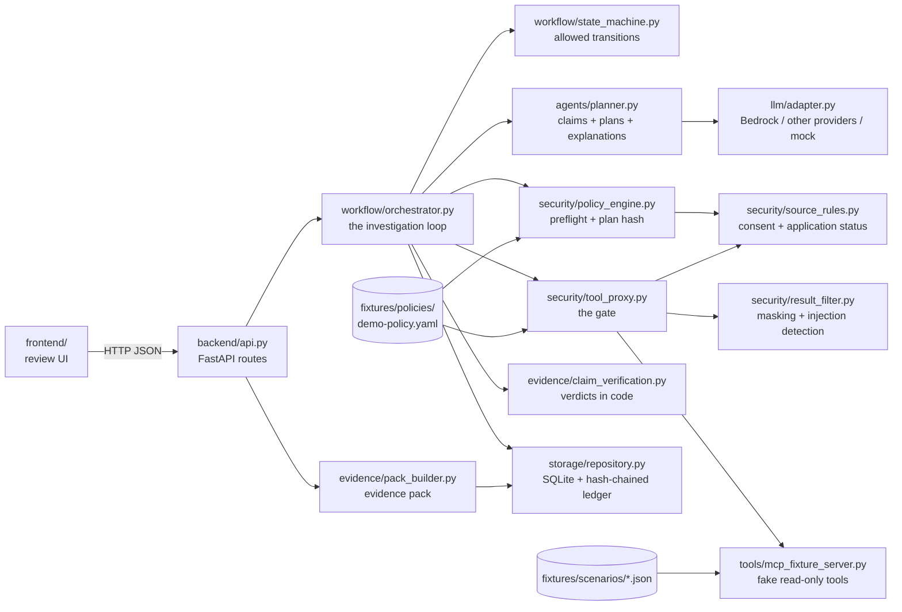

# Architecture

This page explains how Agent Assurance is put together: which module does what, how a case moves through the system, and where the trust boundaries are. Each folder also has its own `README.md` with the details.

## The idea in one paragraph

A bank's AI agent produces a finding ("NOVA Logistics SRL is currently involved in an ongoing legal dispute"). Agent Assurance turns that finding into separate **claims**, lets an **investigation agent** propose a **plan** of read-only lookups, runs a deterministic **legal + policy preflight** on the exact plan, asks a **person to approve that exact plan** (bound to its SHA-256 fingerprint), executes only the approved lookups through a **gate** that fails closed, computes a **verdict per claim in code**, loops back for a new approval if new sources are needed, and ends with a **human sign-off** and an **evidence pack** built from a hash-chained, append-only log.

## Design rules that shape the code

| Rule | Where it is enforced |
|---|---|
| **Rules decide, the model reads and writes.** The LLM may extract claims, propose plans and write explanations. It never sets a verdict, a preflight status, an approval or an access grant. | `agents/planner.py` validates every model answer; verdicts only come from `evidence/claim_verification.py`; preflight only from `security/policy_engine.py` |
| **No tool runs without an approval bound to the current plan hash and an acceptable preflight.** | `security/tool_proxy.py` (`_authorize`) |
| **Any plan change is a new version** with a new hash, a new preflight and a new approval. | `workflow/orchestrator.py` (`decide_plan`, `draft_plan`) |
| **Truth and permission are separate.** `SUPPORTED` does not mean lawful; `ALLOWED` does not mean true. | two enums in `domain/models.py`: `ClaimVerdict` and `PreflightStatus` |
| **Never fake certainty.** A missing source or a failed tool gives `INSUFFICIENT_EVIDENCE` or `NOT_CHECKED`, never `SUPPORTED`. | `evidence/claim_verification.py` |
| **Tool responses and documents are untrusted data.** | `security/result_filter.py` (instruction detection) + `caused_by` check in the proxy |
| **Every state change, decision and tool call is logged** in an append-only, hash-chained ledger. | `storage/repository.py` (`append_event`, SQLite triggers) |
| **Bounded loop:** max 3 approved plans and 8 tool calls per case. | `fixtures/policies/demo-policy.yaml`, checked in the preflight and the proxy |

## Module map



Only `tool_proxy.py` may call the MCP server. Only `claim_verification.py` produces verdicts. Only `policy_engine.py` produces preflight results. Only `orchestrator.py` changes case state, and it checks every move against `state_machine.py`.

## One case, step by step

```mermaid
sequenceDiagram
  autonumber
  participant A as Bank AI agent
  participant O as Orchestrator
  participant P as Planner (LLM or mock)
  participant F as Preflight (rules)
  participant H as Human reviewer
  participant G as Gate (tool proxy)
  participant T as Read-only tools
  participant V as Verifier (code)
  A->>O: finding + subject + purpose (+ trace if captured)
  O->>O: store finding + SHA-256, mark missing trace NOT_CAPTURED
  O->>P: split into claims, list gaps
  P->>O: plan v1 (steps: tool, arguments, claim ids)
  O->>F: preflight on the exact plan + hash
  F->>O: ALLOWED / WITH_CONDITIONS / BLOCKED / LEGAL_REVIEW
  O->>H: plan + preflight
  H->>O: APPROVE (hash) / MODIFY / REJECT
  Note over O: MODIFY or REJECT → new version, new hash, new preflight
  O->>G: run each approved step
  G->>G: 15+ checks; a denial is logged, the tool is never called
  G->>T: allowed call
  T->>G: record
  G->>O: filtered evidence (masked, injection flagged)
  O->>V: claims + evidence
  V->>O: SUPPORTED / CONTRADICTED / INSUFFICIENT_EVIDENCE / NOT_CHECKED
  alt new scope needed and budget left
    O->>P: propose the next plan → back to preflight + approval
  end
  O->>H: findings for final review
  H->>O: SIGN_OFF (not a credit decision)
  O->>O: evidence pack from stored records + ledger
```

The case states (15 of them, in `domain/models.py` → `CaseState`) and their allowed transitions are in `workflow/state_machine.py`:

```
RECEIVED → ASSESSED → PLAN_DRAFTED → { PREFLIGHT_BLOCKED | LEGAL_REVIEW_REQUIRED | AWAITING_PLAN_APPROVAL }
AWAITING_PLAN_APPROVAL → APPROVED → EXECUTING → { FINDINGS_READY | REPLAN_REQUIRED }
FINDINGS_READY → { REPLAN_REQUIRED | AWAITING_FINAL_REVIEW }
REPLAN_REQUIRED → PLAN_DRAFTED              (the loop: new plan, new preflight, new approval)
AWAITING_FINAL_REVIEW → CLOSED_VERIFIED | CLOSED_WITH_ISSUES | CLOSED_UNRESOLVED | CLOSED_BLOCKED
```

## Trust boundaries

| Comes from | Trusted? | How it is handled |
|---|---|---|
| The bank agent's finding | No | Stored with its hash; split into claims; every claim is checked |
| The LLM's output | No | Schema-validated; unknown tools or wrong arguments are rejected; on any doubt the deterministic planner is used and the log says so |
| Tool responses and documents | No | Read as typed fields; identifiers masked; instruction-like text flagged and never followed |
| The policy YAML | Yes (owned by compliance) | Versioned; the version is stored with every preflight and checked again by the gate |
| The human reviewer | Yes, within their role | Roles in `fixtures/users.json`; viewers cannot approve; a reviewer is limited to their cases |

## Where the AI is, and where it is not

| Task | Who does it |
|---|---|
| Split the finding into claims | LLM (or the scripted extractor in mock mode) |
| Propose which tools to call, with which arguments | LLM (or the rule-based planner) |
| Write plain-language explanations of the verdicts (EN + RO) | LLM (verdicts unchanged) |
| Decide whether a plan is allowed | Deterministic preflight (YAML rules) |
| Decide whether a call may run | Deterministic gate |
| Decide whether a claim is supported | Deterministic verifier |
| Approve a plan, sign off a case | A person |

So the system works with the model switched off (`LLM_MODE=mock`, the default and what CI runs), and a wrong model answer can make the plan worse but can never produce an unauthorised call or a false `SUPPORTED`.

## Storage and the evidence pack

- Every domain object is stored as canonical JSON (sorted keys) in SQLite, keyed by type and id (`storage/repository.py`). Default is in memory; `AA_DB=file.sqlite3` persists it.
- Every event stores `previous_event_hash` and `event_hash = sha256(canonical event without its own hash)`. The first event of a case points to `"genesis"`. SQLite triggers abort any `UPDATE` or `DELETE` on the events table.
- The evidence pack (`evidence/pack_builder.py`) is assembled only from stored objects and the ledger, gets its own `pack_sha256`, and `verify_pack` re-checks the pack hash, the chain and that every approval and tool receipt is referenced in the ledger.

## What is simulated

All companies, people, documents, policies and tools are synthetic. The "MCP server" is an in-process fake over `fixtures/scenarios/*.json`; the signature check is a fixture; reviewer identity is a demo header (`X-Reviewer-Id`), not bank IAM. The AI Act section of the pack is marked `UNCONFIRMED` / `NEEDS_LEGAL_CONFIRMATION`: it is supporting evidence, not a compliance certificate.

## Read more

- Specification: `docs/spec/build-spec/01_PROBLEM.md` … `10_RESEARCH_EVIDENCE_AND_ASSUMPTIONS.md`, and the gate spec in `docs/spec/gate/`.
- Priority if two documents disagree: `07_SECURITY_AND_GUARDRAILS` > `06_DATA_MODELS_AND_CONTRACTS` > `03_PIPELINE`.
- Folder READMEs: [backend](../backend/README.md) · [domain](../backend/domain/README.md) · [workflow](../backend/workflow/README.md) · [agents](../backend/agents/README.md) · [llm](../backend/llm/README.md) · [security](../backend/security/README.md) · [tools](../backend/tools/README.md) · [evidence](../backend/evidence/README.md) · [storage](../backend/storage/README.md) · [frontend](../frontend/README.md) · [fixtures](../fixtures/README.md) · [eval](../eval/README.md) · [tests](../tests/README.md) · [ops](../ops/README.md)
