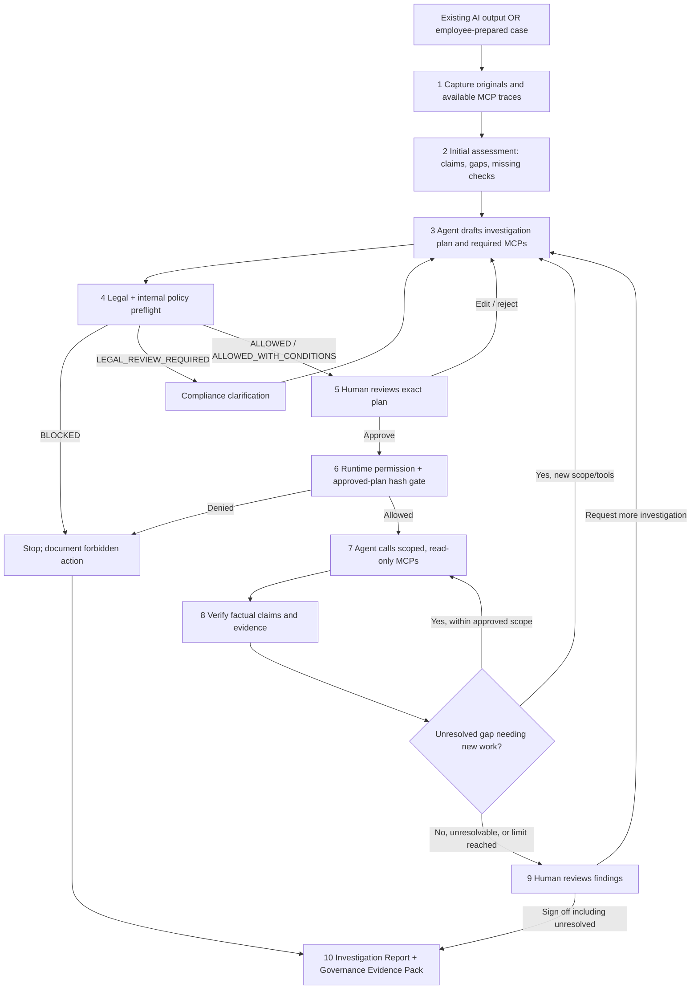

# 03 — Final Pipeline / State Machine

**Contract:** No unapproved action executes. Every plan revision has a new approval. Every investigation includes **evidence verification and legal/policy screening**. No conclusion is forced positive.

## Overview



## State machine (source of truth)

A case has exactly one of these states:

| Case state | Entered when | Allowed next states |
|---|---|---|
| `RECEIVED` | Case accepted, original material captured | `ASSESSED` |
| `ASSESSED` | Claims/gaps extracted | `PLAN_DRAFTED` |
| `PLAN_DRAFTED` | New plan revision persisted | `PREFLIGHT_BLOCKED`, `LEGAL_REVIEW_REQUIRED`, `AWAITING_PLAN_APPROVAL` |
| `PREFLIGHT_BLOCKED` | Hard policy block identified | `PLAN_DRAFTED` (safe replacement) or `CLOSED_BLOCKED` |
| `LEGAL_REVIEW_REQUIRED` | Law/purpose/authority cannot be determined | `PLAN_DRAFTED` after authorized clarification, or `CLOSED_UNRESOLVED` |
| `AWAITING_PLAN_APPROVAL` | Preflight passed/conditioned | `PLAN_DRAFTED` (edit/reject), `APPROVED` |
| `APPROVED` | Exact plan revision approved by authorized reviewer | `EXECUTING` or `CLOSED_BLOCKED` (permission expired/changed) |
| `EXECUTING` | Permitted tool operations running | `FINDINGS_READY`, `REPLAN_REQUIRED`, `CLOSED_BLOCKED` |
| `FINDINGS_READY` | Claim-level checks completed for current scope | `REPLAN_REQUIRED`, `AWAITING_FINAL_REVIEW` |
| `REPLAN_REQUIRED` | Need different scope, source, tool, budget, or a new hypothesis | `PLAN_DRAFTED` |
| `AWAITING_FINAL_REVIEW` | Findings prepared, no allowed autonomous next step outstanding | `REPLAN_REQUIRED`, any `CLOSED_*` |
| `CLOSED_VERIFIED` | Human signs off findings with all required checks supported | Terminal |
| `CLOSED_WITH_ISSUES` | Human signs off with documented contradictions/known problems | Terminal |
| `CLOSED_UNRESOLVED` | Insufficient evidence, legal ambiguity, budget exhausted, source unavailable | Terminal |
| `CLOSED_BLOCKED` | Policy forbids investigation or execution cannot lawfully continue | Terminal |

**Separate axes:** A case's closure state is distinct from individual claim status (`SUPPORTED`, `CONTRADICTED`, `INSUFFICIENT_EVIDENCE`, `NOT_CHECKED`) and from plan preflight status (`ALLOWED`, `ALLOWED_WITH_CONDITIONS`, `BLOCKED`, `LEGAL_REVIEW_REQUIRED`). Do not conflate these values.

## Detailed contract by stage

### 1. Case ingestion / snapshot

**Input:** `{origin: AI_AGENT | HUMAN, case_id, intended_purpose, claims_or_text, initial_source_refs?, original_tool_events?, ai_system_context?}`. Use only artifacts already available to the reviewer under existing permissions. **No new external research before plan approval.**

**Output:** Original payload hash + stable references; mark absent traces `NOT_CAPTURED`. Never backfill logs by LLM imagination.

### 2. Initial assessment

AI extracts atomic claims (e.g., “dispute existed in 2024” and “dispute remains open now”) and missing-evidence hypotheses. Deterministic parsers identify absent timestamps, mismatched IDs, and document metadata. Every claim must have a stable `claim_id` and proposed evidence needs.

### 3. Investigation planning (agentic)

Plan is **specific** rather than “research the company.” Each step contains:
- objective + claim IDs;
- `tool_id`, action, approved source classes and exact allowed domains where applicable;
- permissible data categories and intended purpose;
- dependencies, stop condition, per-step and total call budgets;
- estimated legal/privacy flags and expected output artifact.

Agent can propose a plan; cannot add MCP permissions or declare an action lawful.

### 4. Legal + policy preflight (mandatory before human approval)

**Preflight uses:** approved versioned rule set, AI system intended purpose, case purpose, role/authorization, permitted data categories, MCP registry and restrictions, applicable legal rules, and policy revision ID.

| Preflight result | Behavior |
|---|---|
| `ALLOWED` | Human may approve; runtime gate still checks each call |
| `ALLOWED_WITH_CONDITIONS` | Human sees explicit limits; approved token includes them |
| `BLOCKED` | Cannot be approved as-is; revise/stop, log reason |
| `LEGAL_REVIEW_REQUIRED` | Pause; escalate to authorized Compliance/DPO as applicable; no execution |

Legal assistant can cite and recommend. **The enforceable decision comes from deterministic bank-approved policy and humans with defined authority.** Lack of a configured lawful basis for personal-data processing is **not** resolved by an LLM saying “legitimate interest.”

### 5. Approval loop

Reviewer sees plan diff, what data is sought, tools, possible personal data, purpose, limits, and legal preflight. Buttons: **Approve / Modify / Reject / Request Compliance**.

**On modify/reject:** Add reviewer restrictions, create vN+1, invalidate prior approval token, rerun preflight, and ask again. **On approval:** Store reviewer ID, role, timestamp, exact plan digest, preflight/policy version, scope limits, and decision event.

### 6. Deterministic execution gate

Every tool call requires valid scoped approval and current policy allow. Check prior to invocation:

`role_allowed ∧ user_authorized ∧ preflight_acceptable ∧ plan_hash_matches ∧ tool_in_plan ∧ action_in_plan ∧ source_allowed ∧ data_category_allowed ∧ case_purpose_matches ∧ budgets_remaining ∧ not_revoked`.

If any check fails: **deny tool call, log the denial, and move to replan/block**. Human approval **cannot** override a hard law/security prohibition.

### 7. Adaptive investigation

Agent may select the next action among plan-approved steps. It may choose fewer tool calls, stop early, and request another plan if needed. It **may not** add new domains/tools, retrieve extra personal-data categories, broaden the population or purpose, or continue after expiration of approval. Each tool response is treated as **untrusted data**, not instructions.

### 8. Claim and source verification

- Retrieve and preserve source identifiers, version, time and raw snapshot **if lawful and available**.
- Check exact identifiers, field types, dates and valid signatures using code/official verification where supported.
- Use AI for unstructured evidence reasoning, with claim-specific passages/citations.
- Assign one verdict per claim with reason + supporting and contradicting evidence IDs.
- Distinguish `source_exists`, `source_is_authorized`, `content_supports_claim`, and `authenticity_verified`—these are not equivalent.
- Do not derive “true” from a second LLM's agreement.

### 9. Stop/replan/review

Replan if new lawful lookup is needed. If a source cannot be reached, evidence cannot resolve a conflict, a policy is unclear, or budget expires: `INSUFFICIENT_EVIDENCE` and possible `CLOSED_UNRESOLVED` after reviewer signoff. **No infinite loops**; default MVP max 3 approved investigation plans and 8 total tool calls (configurable).

### 10. Evidence generation

Two outputs from the same append-only event sequence:
- **Investigation Report:** findings by claim, evidence citations, what is unresolved, next steps.
- **Governance Evidence Pack:** exact plan versions and approvals, preflight and policy identifiers, MCP tool invocation receipts, reviewer decisions, legal applicability notes, gaps and integrity digest.

Generate a provisional pack even for `CLOSED_BLOCKED` or `CLOSED_UNRESOLVED`; do not hide negative results.

## Pseudocode — enforceable behavior

```python
case = ingest_case(payload)
assessment = assess_existing_artifacts(case)   # no new external calls

for plan_index in range(MAX_APPROVED_PLANS):
    proposal = planner.propose(case, assessment, allowed_tool_catalog)
    assessment_of_plan = policy_preflight(proposal, case, versioned_rules)

    if assessment_of_plan.status == 'BLOCKED':
        case.record_policy_block(proposal, assessment_of_plan)
        if no_safe_alternative(proposal): break
        continue
    if assessment_of_plan.status == 'LEGAL_REVIEW_REQUIRED':
        case.pause_for_compliance()              # do not invoke any tool
        break

    decision = await_human_plan_decision(proposal, assessment_of_plan)
    if decision.type != 'APPROVE':
        case.record_restrictions(decision)
        continue                                # new plan + new preflight

    token = bind_approval_to_plan_hash(proposal, decision)
    while within_budgets(token):
        step = planner.choose_next_approved_step(proposal, case.findings)
        if not step: break
        receipt = gated_tool_proxy.invoke(step, token)  # fail closed
        case.append(receipt)
        case.findings = verifier.update(case.findings, receipt)
        if new_permission_or_source_needed(case.findings): break

    assessment = reassess_gaps(case)
    if not needs_new_approved_scope(assessment): break

await_final_human_review(case)                # including unresolved outcome
pack = assemble_event_backed_evidence(case)
```

**Note:** Demo implementation may use mocked tools and a synchronous UI, but the approval and tool gate **must actually be enforced by code** rather than simulated only in prompts.

## Demo anchor

`NOVA Logistics SRL`, fictitious identifier `RO-DEMO-48219370`. Historical article (2024) says a dispute was active; latest authorized registry (2026) says closed. Human first rejects a plan with unrestricted search, approves a plan with two whitelisted read-only sources, and approves a second source-authenticity step only if needed. See `08_DEMO_SCENARIOS_AND_TESTS.md`.
